<p align="center"></p>

<p align="center">


</p>

```
★ i build the whole thing: the pipeline, the model, the cloud, the app.
★ then i test it so it doesn't lie to me.
```

## ✦ THE WORK

| | | |
|:--|:--|:--|
| ★&nbsp;**[SCOUTLINE](https://github.com/tttamannaanand/ScoutLine)** | xG model on 38k real shots. finds the bargains scouts miss. | **[→&nbsp;live](https://scout-line.vercel.app)** |
| ★&nbsp;**[LOTWISE](https://github.com/tttamannaanand/Lotwise-AWS)** | indian capital gains from any broker's messy CSV. | **[→&nbsp;live](https://7rml52kocf.execute-api.us-east-1.amazonaws.com)** |
| ★&nbsp;**[LUNG&nbsp;RISK](https://github.com/tttamannaanand/lungrisk)** | validated lung cancer risk model + india's air in cigarettes/day. | **[→&nbsp;check](https://tttamannaanand.github.io/lungrisk/)** |
| ★&nbsp;**[LUMIDO](https://github.com/tttamannaanand/Lumido)** | 200 drone photos in, 25 million 3D points out. | **[→&nbsp;spin](https://tttamannaanand.github.io/Lumido/)** |
| ★&nbsp;**[WHIT](https://github.com/tttamannaanand/WHIT)** | five minutes a day. paywall enforced server-side. | **[→&nbsp;demo](https://tttamannaanand.github.io/WHIT/)** |
| ★&nbsp;**[TINTA](https://github.com/tttamannaanand/Tinta)** | type a mood, get its colours, art and soundtrack. | **[→&nbsp;code](https://github.com/tttamannaanand/Tinta)** |
| ★&nbsp;**[WARD&nbsp;ZERO](https://github.com/tttamannaanand/wardzero)** | ransomware loose in a hospital network, 300 seeded runs. | **[→&nbsp;replay](https://tttamannaanand.github.io/wardzero/)** |
| ★&nbsp;**[KVLITE](https://github.com/tttamannaanand/kvlite)** | raft key-value store in rust. kill -9 the leader, lose nothing. | **[→&nbsp;code](https://github.com/tttamannaanand/kvlite)** |
| ★&nbsp;**[QUARTET](https://github.com/tttamannaanand/quartet)** | four quant models from scratch on real market data. | **[→&nbsp;read](https://tttamannaanand.github.io/quartet/)** |
| ★&nbsp;**[SKYWATCH](https://github.com/tttamannaanand/skywatch)** | nasa daily, live planets, asteroid flybys, exoplanet hunter. | **[→&nbsp;look](https://tttamannaanand.github.io/skywatch/)** |
| ★&nbsp;**[GHOST&nbsp;TABS](https://github.com/tttamannaanand/ghosttabs)** | chrome extension. ignored tabs fade into ghosts. | **[→&nbsp;haunt](https://github.com/tttamannaanand/ghosttabs)** |
| ★&nbsp;**[PIXEL&nbsp;PETS](https://github.com/tttamannaanand/pixelpets)** | my two cats and dog, living on top of my screen. | **[→&nbsp;adopt](https://github.com/tttamannaanand/pixelpets)** |
| ★&nbsp;**[GODMODE](https://github.com/tttamannaanand/godmode)** | cheat codes for students: paid open source, funded research. | **[→&nbsp;unlock](https://github.com/tttamannaanand/godmode)** |
| ★&nbsp;**[STASH](https://github.com/tttamannaanand/stash)** | 398 free design resources, every licence labelled. | **[→&nbsp;raid](https://github.com/tttamannaanand/stash)** |

## ✦ THE KIT

```
cloud
```
<p>


</p>

```
data · ml · quant
```
<p>


</p>

```
apps · web · games
```
<p>


</p>

## ✦ NOW

```
> building a space project with real nasa data. the planets, live.
> and a space project. pointing code at the sky.
```

<p align="center">☆ ☆ ☆</p>
