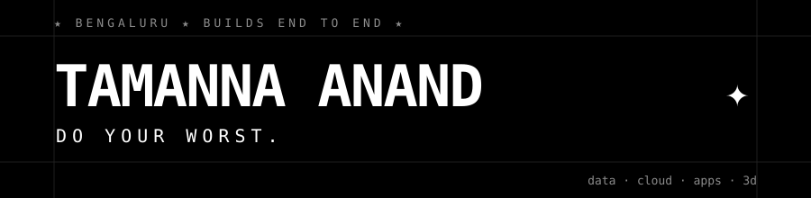

<p align="center"></p>

<p align="center">


</p>

```
★ i build the whole thing: the pipeline, the model, the cloud, the app.
★ then i test it so it doesn't lie to me.
```

## ✦ THE WORK

| | | |
|:--|:--|:--|
| ★ **[SCOUTLINE](https://github.com/tttamannaanand/ScoutLine)** | from-scratch xG model on 38k real shots. pass networks. finds the bargains scouts miss. | **[→ live](https://scout-line.vercel.app)** |
| ★ **[LOTWISE](https://github.com/tttamannaanand/Lotwise-AWS)** | indian capital gains from any broker's mess of a CSV. FIFO lots, FY tax rules, AI that never touches the maths. | **[→ live](https://7rml52kocf.execute-api.us-east-1.amazonaws.com)** |
| ★ **[LUNG RISK CHECK](https://github.com/tttamannaanand/lungrisk)** | lung cancer risk from a validated model. matches the reference implementation on 500 people to 15 decimal places. shows where US and UK screening rules disagree. plus: india's air, live, in cigarettes per day. | **[→ check yours](https://tttamannaanand.github.io/lungrisk/)** |
| ★ **[LUMIDO](https://github.com/tttamannaanand/Lumido)** | 200 drone photos in. 25 million 3D points out. own matching, own stereo, own fusion. | **[→ spin it](https://tttamannaanand.github.io/Lumido/)** |
| ★ **[WHIT](https://github.com/tttamannaanand/WHIT)** | five minutes a day. paywall enforced server-side, because clients lie. | **[→ demo](https://tttamannaanand.github.io/WHIT/)** |
| ★ **[TINTA](https://github.com/tttamannaanand/Tinta)** | type a mood. get its colours, its art, its soundtrack. | **[→ source](https://github.com/tttamannaanand/Tinta)** |
| ★ **[WARD ZERO](https://github.com/tttamannaanand/wardzero)** | ransomware loose in a hospital network. ATT&CK-tagged, 300 seeded runs. locking down admin accounts cuts ambulance diversion from 285 h to 15. | **[→ replay](https://tttamannaanand.github.io/wardzero/)** |
| ★ **[KVLITE](https://github.com/tttamannaanand/kvlite)** | key-value store in rust, now a raft cluster. kill -9 the leader; nothing's lost. a jepsen-style simulator catches the raft paper's figure-8 bug. | **[→ source](https://github.com/tttamannaanand/kvlite)** |
| ★ **[QUARTET](https://github.com/tttamannaanand/quartet)** | four quant models from scratch on real data. fama-french, regime switching, longstaff-schwartz, heston. cheating with hindsight makes 16.3% a year; honestly, 7.5%. | **[→ read it](https://tttamannaanand.github.io/quartet/)** |
| ★ **[GODMODE](https://github.com/tttamannaanand/godmode)** | cheat codes for students. paid open source, funded research abroad, weird competitions. | **[→ unlock](https://github.com/tttamannaanand/godmode)** |
| ★ **[STASH](https://github.com/tttamannaanand/stash)** | 398 free design resources. icons, lottie, overlays, pixel art, fonts. every licence labelled. | **[→ raid it](https://github.com/tttamannaanand/stash)** |

## ✦ THE KIT

```
cloud
```
<p>


</p>

```
data · ml · quant
```
<p>


</p>

```
apps · web · games
```
<p>


</p>

## ✦ NOW

```
> building a google chrome extension. lives in your browser, does one thing well.
> and a space project. pointing code at the sky.
```

<p align="center">☆ ☆ ☆</p>
